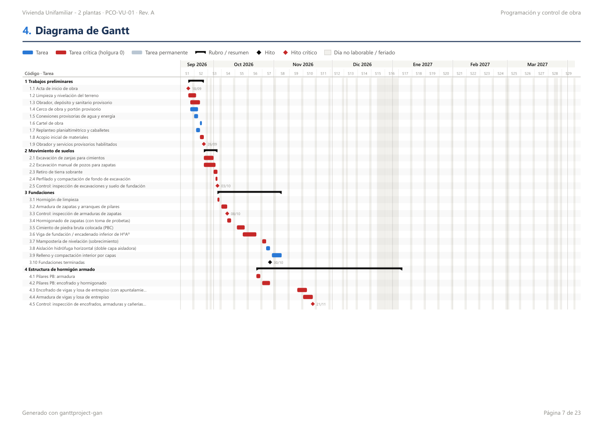
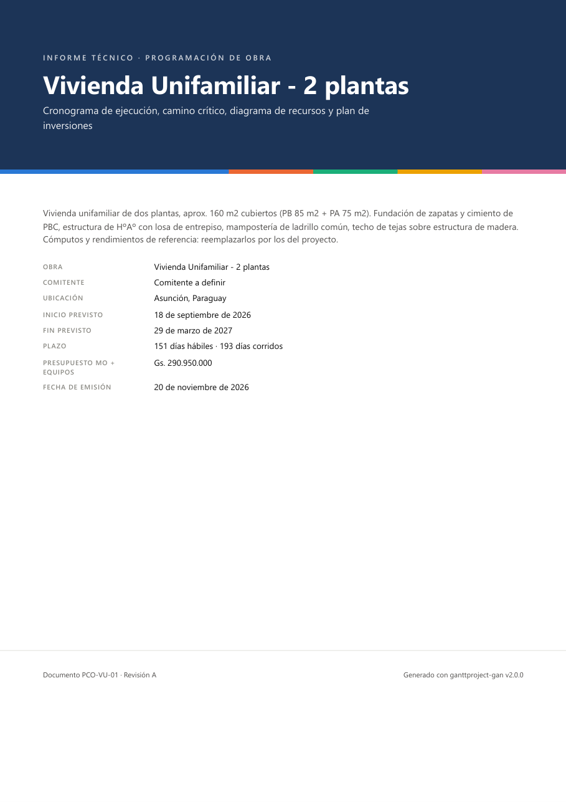
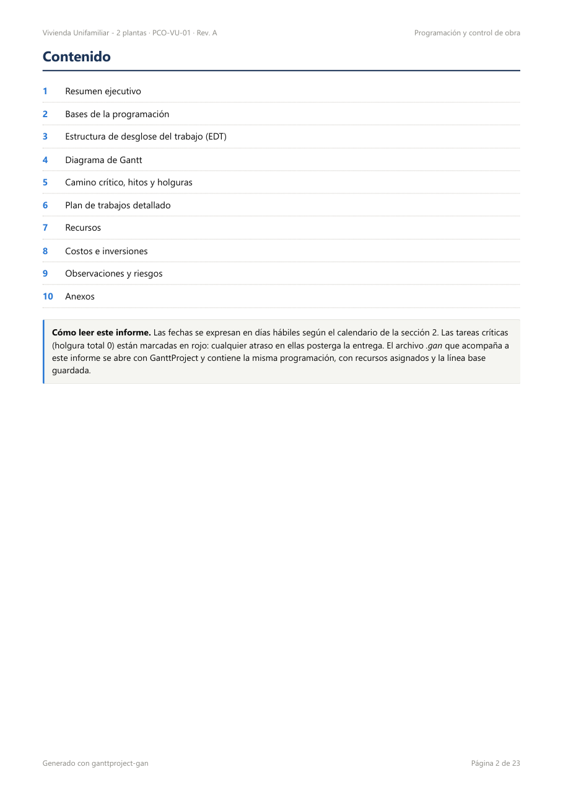
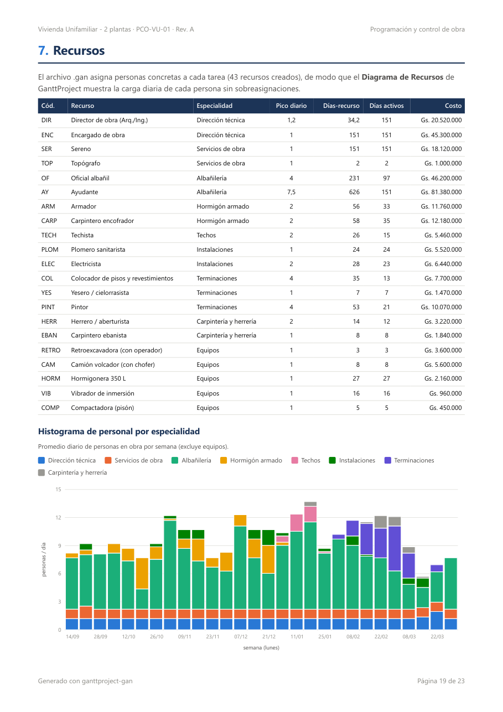
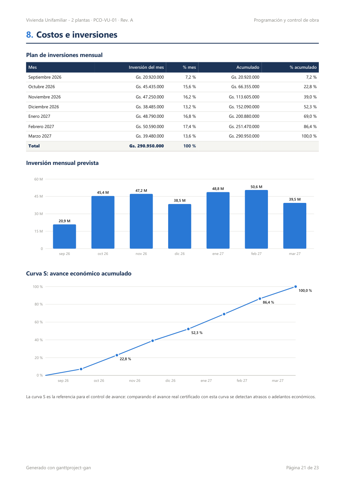

<div align="center">

# ganttproject-gan

**Cronogramas de obra completos para GanttProject, generados desde un archivo JSON.**
Diagrama de Gantt, Diagrama de Recursos, camino crítico, nivelación, costos, curva S e informe técnico en PDF.

[](https://github.com/jvchiappini/ganttproject-gan-skill/actions/workflows/ci.yml)
[](LICENSE)




</div>

---

`ganttproject-gan` es una **Agent Skill** (y a la vez un conjunto de herramientas de línea de comandos) que
convierte la descripción de una obra (rubros, cómputos, rendimientos, cuadrillas y precedencias) en:

- un archivo **`.gan`** que se abre directamente en [GanttProject](https://www.ganttproject.biz/), con la
  programación calculada, los recursos asignados y la línea base guardada;
- un **informe técnico** en HTML y PDF listo para entregar;
- la **auditoría** de cualquier `.gan` existente, para ver qué le falta.

Está pensada para la cátedra de *Programación y Control de Obras* y para profesionales de la construcción,
con calendario de días hábiles, feriados de Paraguay y Argentina, recesos y unidades de obra.

## Contenido

- [Características](#características)
- [Galería](#galería)
- [Instalación](#instalación)
- [Uso rápido](#uso-rápido)
- [Especificación JSON](#especificación-json)
- [Herramientas](#herramientas)
- [Cómo funciona](#cómo-funciona)
- [Desarrollo](#desarrollo)
- [Licencia](#licencia)

## Características

| | |
|---|---|
| **Calendario real** | Días laborables configurables, feriados PY/AR calculados para cada año (incluida Semana Santa), feriados extra y recesos. |
| **Duraciones por cómputo** | `ceil(cantidad ÷ (rendimiento × cuadrillas))`, en días hábiles. También se acepta la duración directa. |
| **CPM completo** | Dependencias FS, SS, FF y SF con desfasajes, holgura total y libre, camino crítico e hitos. |
| **Diagrama de Recursos** | Crea personas concretas ("Oficial albañil 1, 2…") y las asigna sin superposiciones; también admite el modo agrupado por especialidad. |
| **Nivelación** | Método serie con prioridad de menor inicio tardío. Respeta la dotación disponible y la preserva en GanttProject con restricciones *inicio no antes de*. |
| **Costos** | Tarifa diaria por recurso más materiales (opcionales), costo por tarea y por rubro, plan de inversiones mensual y curva S. |
| **GanttProject al máximo** | EDT numerada, columnas personalizadas (cómputo, cuadrilla, costo, holgura), notas automáticas, colores por rubro, roles, tarifas y línea base. |
| **Informe técnico** | 10 secciones con portada, resumen ejecutivo, Gantt apaisado, histograma, curva S, observaciones y firmas. HTML autocontenido y PDF. |
| **Auditoría** | Detecta cabos sueltos, feriados faltantes, sobreasignaciones, falta de hitos, recursos, costos o línea base. |
| **Ida y vuelta** | Convierte un `.gan` hecho a mano en JSON, para completarlo y regenerarlo sin perder su estructura. |
| **Sin dependencias** | Solo la biblioteca estándar de Python 3.8 o superior. Funciona en Windows, macOS y Linux. |

## Galería

<table>
<tr>
<td></td>
<td></td>
</tr>
<tr>
<td></td>
<td></td>
</tr>
</table>

Ejemplo completo en [`examples/vivienda-unifamiliar/`](examples/vivienda-unifamiliar): el archivo `.gan`,
el informe en [HTML](examples/vivienda-unifamiliar/informe.html) y [PDF](examples/vivienda-unifamiliar/informe.pdf),
el resumen y los CSV.

## Instalación

### Como skill para agentes (Claude Code, Cursor, Codex, Gemini CLI…)

```bash
npx skills add jvchiappini/ganttproject-gan-skill
```

O de forma manual, copiando la carpeta de la skill:

```bash
git clone https://github.com/jvchiappini/ganttproject-gan-skill.git
cp -r ganttproject-gan-skill/skills/ganttproject-gan ~/.claude/skills/
```

Después basta con pedirle al agente, por ejemplo: *"Haceme el cronograma completo de una vivienda de 2 plantas
en GanttProject, con recursos e informe"*.

### Como herramienta de línea de comandos

No hace falta instalar nada: solo se necesita Python 3.8 o superior.

```bash
git clone https://github.com/jvchiappini/ganttproject-gan-skill.git
cd ganttproject-gan-skill/skills/ganttproject-gan/scripts
```

## Uso rápido

```bash
# 1. Generar el cronograma (.gan) con resumen y CSV
python generar_gan.py ../assets/plantillas/vivienda_unifamiliar_completa.json obra.gan --resumen resumen.md --csv csv/

# 2. Auditarlo
python validar_gan.py obra.gan

# 3. Informe técnico (HTML y, si hay Edge o Chrome, también PDF)
python informe.py ../assets/plantillas/vivienda_unifamiliar_completa.json informe.html --pdf informe.pdf

# 4. Completar un .gan existente hecho a mano
python validar_gan.py "Mi obra.gan"            # ¿qué le falta?
python gan_a_json.py "Mi obra.gan" mi_obra.json # editar el JSON y volver al paso 1
```

Salida típica:

```text
OK -> obra.gan
Tareas: 131 (113 hojas, 18 grupos) | Recursos: 43 | Asignaciones: 305
Inicio 2026-09-18 | Fin 2027-03-29 | 151 días hábiles
Costo total: 290.950.000
Camino crítico: 1.1 -> 1.2 -> 1.3 -> 1.8 -> 1.9 -> 2.1 -> ... -> 16.7
Retrasadas por nivelación: 4.10, 4.11, 9.1, 9.3, 9.4, 15.1
```

## Especificación JSON

Esquema completo con autocompletado en VS Code:
[`schema/cronograma.schema.json`](skills/ganttproject-gan/schema/cronograma.schema.json).

```json
{
  "$schema": "./schema/cronograma.schema.json",
  "proyecto":   { "nombre": "Vivienda", "inicio": "2026-09-18" },
  "informe":    { "documento": "PCO-01", "revision": "A", "elaboro": "Nombre - cargo", "moneda": "Gs." },
  "calendario": { "dias_laborables": ["lun","mar","mie","jue","vie","sab"], "feriados_preset": "PY",
                  "periodos_no_laborables": [{ "desde": "2026-12-24", "hasta": "2027-01-02", "nombre": "Receso" }] },
  "recursos": [
    { "id": "OF", "nombre": "Oficial albañil", "rol": "Albañilería", "costo_dia": 200000, "disponibles": 4 },
    { "id": "AY", "nombre": "Ayudante",        "rol": "Albañilería", "costo_dia": 130000 }
  ],
  "tareas": [
    { "id": "1", "nombre": "Mampostería", "hijos": [
      { "id": "1.1", "nombre": "Inicio", "hito": true },
      { "id": "1.2", "nombre": "Muros PB", "cantidad": 260, "unidad": "m2", "rendimiento": 9,
        "cuadrillas": 3, "predecesoras": ["1.1"], "recursos": { "OF": 3, "AY": 3 } },
      { "id": "1.3", "nombre": "Marcos", "duracion": 3, "predecesoras": ["1.2SS+3"], "recursos": { "OF": 1, "AY": 1 } }
    ]}
  ]
}
```

| Campo de tarea | Descripción |
|---|---|
| `duracion` | Días hábiles. |
| `cantidad`, `unidad`, `rendimiento`, `cuadrillas` | La duración se calcula a partir del cómputo. |
| `hito` | Hito de duración 0. |
| `abarca_obra` | Tarea permanente que dura toda la obra (dirección, sereno, limpieza). |
| `predecesoras` | `"3.1"` (FS), `"3.1SS"`, `"3.1FF+2"`, `"4.1SS-1"`, en castellano `CF`/`CC`/`FC`, u objeto `{id, tipo, desfase}`. |
| `recursos` | `{ "OF": 3, "AY": 3 }`: cantidad total por tipo; admite fracciones. |
| `costo_materiales` / `precio_unitario_material` | Costo de materiales de la tarea. |
| `inicio_no_antes`, `avance`, `notas`, `color`, `prioridad`, `responsable` | Opcionales. |

## Herramientas

| Script | Entrada → salida |
|---|---|
| [`generar_gan.py`](skills/ganttproject-gan/scripts/generar_gan.py) | JSON → `.gan` (+ `--resumen` Markdown, `--csv` con tareas, histograma semanal y curva S) |
| [`informe.py`](skills/ganttproject-gan/scripts/informe.py) | JSON → informe `.html` (+ `--pdf` con Edge o Chrome sin interfaz) |
| [`validar_gan.py`](skills/ganttproject-gan/scripts/validar_gan.py) | `.gan` → auditoría (`--json` para integrarla con otras herramientas; código de salida 1 si hay errores) |
| [`gan_a_json.py`](skills/ganttproject-gan/scripts/gan_a_json.py) | `.gan` → JSON editable |

Recursos para el agente: [`SKILL.md`](skills/ganttproject-gan/SKILL.md),
[formato `.gan`](skills/ganttproject-gan/references/formato_gan.md),
[guía de obra](skills/ganttproject-gan/references/guia_obra.md) y la
[plantilla completa](skills/ganttproject-gan/assets/plantillas/vivienda_unifamiliar_completa.json)
(17 rubros, 113 tareas, 9 hitos y 21 tipos de recurso).

## Cómo funciona

```text
JSON ──► Calendario (días hábiles + feriados + recesos)
     ──► Duraciones (cómputo ÷ rendimiento × cuadrillas)
     ──► CPM hacia adelante ──► nivelación (serie, menor inicio tardío) ──► CPM hacia atrás con vínculos de recurso
     ──► Rubros (rollup) ──► asignación de personas sin superposición ──► costos
     ──► XML .gan  ·  resumen .md  ·  CSV  ·  informe HTML/PDF
```

El formato `.gan` se verificó contra el código fuente de GanttProject (`TaskSaver`, `ResourceSaver`,
`AssignmentSaver`, `SchedulerImpl` y `XmlSerializer`) y contra archivos reales guardados por la aplicación.
Un archivo hecho a mano en GanttProject y regenerado por esta herramienta conserva **todas** sus fechas
(lo prueba la suite de tests).

## Desarrollo

```bash
python -m unittest discover -s tests -v
```

La integración continua ejecuta los tests en Linux y Windows con Python 3.8 a 3.13, regenera el ejemplo y lo
audita. Para contribuir, ver [CONTRIBUTING.md](CONTRIBUTING.md); los cambios están en [CHANGELOG.md](CHANGELOG.md).

## Licencia

[MIT](LICENSE). GanttProject es un proyecto independiente de bardsoftware, con licencia GPL v3; esta herramienta
solo genera archivos compatibles con su formato y no incluye código de GanttProject.

> Los cómputos, rendimientos y costos de la plantilla son **valores de referencia**: reemplazalos por los de tu
> proyecto, tu región y tu cátedra.
